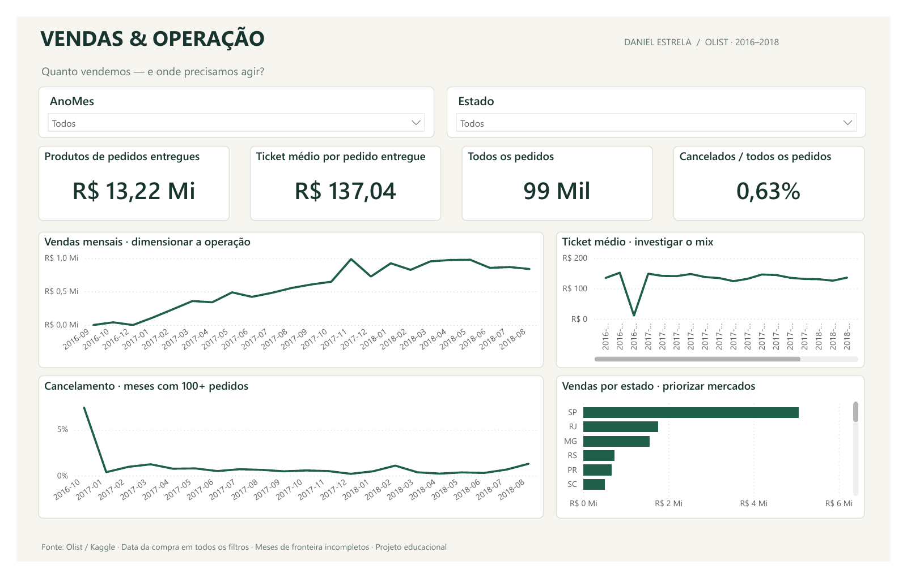
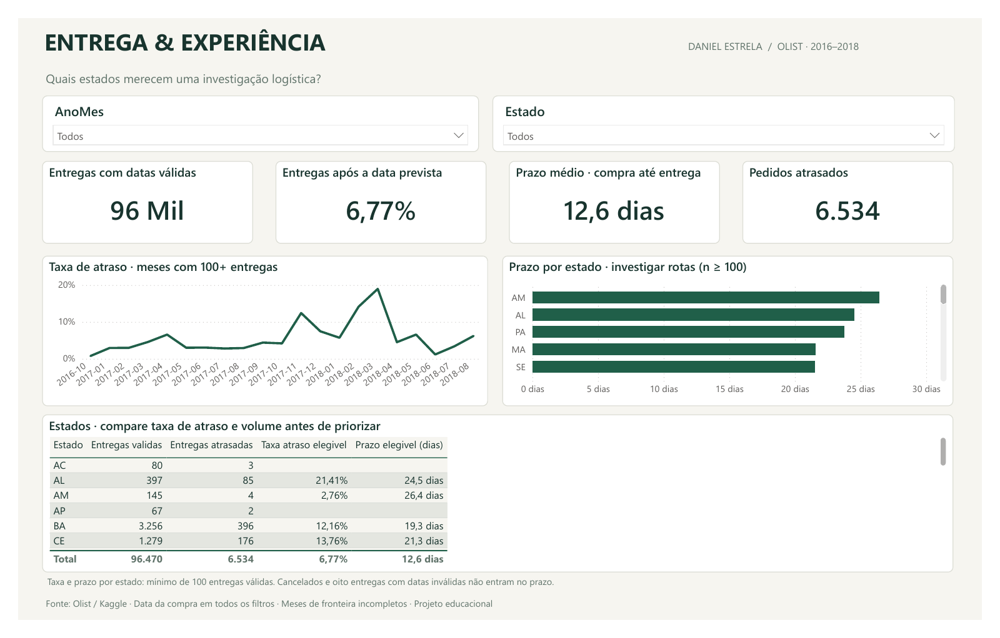
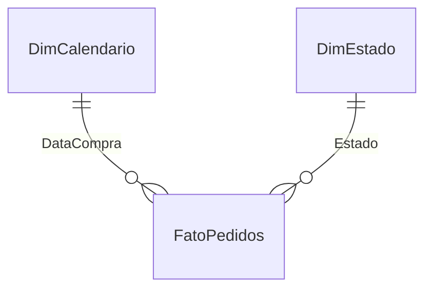

# Dashboard Power BI · Comercial e logística

Painel de portfólio de **Daniel Estrela** sobre vendas, cancelamentos e entregas, com a mesma base pública Olist do projeto SQL.

**[Baixar o painel com dados (.pbix)](Olist-Dashboard-v1.pbix?raw=true)** · [Medidas DAX](medidas.dax) · [Métricas e decisões](METRICAS.md)

[Ver prévias online](https://danielestrela-dev.github.io/ecommerce-sql-olist/powerbi.html) · [Abrir exportação em PDF](Olist-Dashboard.pdf)

## Telas

### 01 · Comercial



Produtos de pedidos entregues, ticket médio, quantidade de pedidos e cancelamento. Os gráficos ajudam a dimensionar a operação, investigar o mix, localizar períodos com cancelamento elevado e priorizar mercados.

### 02 · Logística



Volume de entregas válidas, taxa de atraso, prazo médio e quantidade de atrasados. A evolução mensal e a comparação de estados ajudam a selecionar períodos e rotas para investigação.

## Abrir e usar

1. Baixe **Olist-Dashboard-v1.pbix** e abra no Power BI Desktop atualizado. Os dados já estão incorporados; não é preciso atualizar para navegar.
2. Escolha a página Comercial ou Logística e use os filtros de mês da compra e estado.
3. Clique em um ponto, barra ou estado para explorar o recorte; clique novamente ou em uma área vazia para limpar a seleção do visual. Os filtros de cada página são independentes.
4. Para atualizar os dados, edite o parâmetro `PastaDados` no Power Query para apontar à pasta `powerbi/data` desta cópia do repositório, que contém `pedidos.csv.gz`.

O relatório foi salvo no Power BI Desktop **2.159.883.0 (outubro de 2026)**, com o formato PBIR. Versões antigas podem pedir atualização ou habilitação do formato aprimorado.

## Modelo e arquivos editáveis

O [Olist.pbip](Olist.pbip) abre o projeto de desenvolvimento, que usa um **modelo estrela**:



- **FatoPedidos:** 99.441 linhas, uma por pedido, incluindo todos os status. Itens e fretes são agregados antes da junção.
- **DimCalendario:** calendário contínuo de 2016 a 2018. A relação ativa usa a data da compra, inclusive para os gráficos de logística.
- **DimEstado:** 27 UFs, com relação de um para muitos e filtro em uma direção.
- **16 medidas explícitas:** contagens, valores, razões, comparação mensal e critérios mínimos de volume.

O projeto mantém definições de relatório em PBIR e modelo em TMSL (`model.bim`), formatos de projeto do Power BI. As medidas já estão no modelo; `medidas.dax` é uma referência legível, não um arquivo para importar inteiro no editor de medidas.

## Reproduzir a preparação

Na raiz do repositório:

```bash
python scripts/build.py
python powerbi/scripts/build_dashboard.py
```

O primeiro comando reproduz o banco a partir da fonte Olist. O segundo gera a tabela preparada, o arquivo compactado, o modelo, as medidas e o layout. Depois, abra `powerbi/Olist.pbip`, ajuste `PastaDados` se necessário e clique em **Atualizar**. Para gerar o `.pbix`, use **Salvar como → Arquivo do Power BI** no aplicativo.

O `.pbix` contém o modelo importado. O `.pbip` contém as definições; em uma nova máquina exige atualizar a base local antes de visualizar os valores.

## Validação

- Contagens de pedidos, entregues, cancelados e entregas válidas reconciliadas com a base de origem.
- Garantia de uma linha por pedido e confirmação de que todos os pedidos entregues têm valor de produtos para o denominador do ticket.
- Medidas DAX executadas no mecanismo do Power BI e comparadas aos cálculos de referência em [validation/expected.json](validation/expected.json).
- Filtro de São Paulo em março de 2018 e comparação com o mês anterior conferidos; registro em [validation/native-validation.json](validation/native-validation.json).
- Arquivo `.pbix` salvo e reaberto no Power BI Desktop com dados incorporados.

Os scripts `inspect_engine.ps1`, `refresh_engine.ps1` e `query_engine.ps1` são auxiliares opcionais da validação local, via bibliotecas instaladas com o Power BI. A porta e o identificador do modelo mudam em cada sessão; não são necessários para usar o painel.

## Fonte, licença e limites

Fonte: **Olist — Brazilian E-Commerce Public Dataset**, [Kaggle](https://www.kaggle.com/datasets/olistbr/brazilian-ecommerce), sob [CC BY-NC-SA 4.0](https://creativecommons.org/licenses/by-nc-sa/4.0/). Os dados transformados e resultados derivados mantêm essa licença. O arquivo preparado troca os identificadores originais por uma chave numérica e não contém nomes, contatos, endereços nem comentários.

Dados históricos e observacionais. “Vendas” significa valor dos produtos de pedidos entregues, sem frete, custos, impostos ou devoluções. Não mede lucro, receita líquida ou desempenho atual da Olist. Meses de fronteira são incompletos; o mínimo de 100 registros reduz comparações com amostras pequenas, mas não garante significância estatística.

Projeto educacional independente, elaborado com apoio de IA na implementação e documentação. A publicação no GitHub disponibiliza arquivos e imagens; o relatório interativo nativo é aberto no Power BI Desktop.
